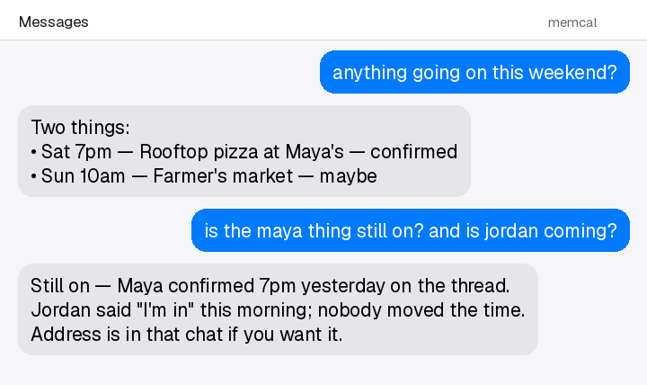

# memcal

**Memory and calendar for AI agents**

[](https://pypi.org/project/memcal/)
[](https://www.python.org/downloads/)
[](LICENSE)
[](https://cuuush.github.io/memcal/)

Memcal gives your agent a memory of your plans, conversations, and commitments. It brings together sources such as iMessage, email, WhatsApp, and calendars, then uses a nightly **Dream** pass to update events and other memories as things change.

Ask “What's my weekend looking like?” and your agent can recall a possible dinner with a friend, a community event, or a family visit—even when those plans started in different conversations.



Memcal prepares a brief of the next 30 days so an agent can answer common questions without a separate lookup. The brief tells you if its token budget leaves events out. Events keep their history and evidence: a past appointment does not automatically mean you attended it.

## Get started

You'll need Python 3.11+, SQLite with FTS5, and a model backend. Codex is the default; Claude Code, Antigravity, Grok, OpenRouter, and OpenAI-compatible APIs are also supported.

```bash
pip install memcal
memcal setup
memcal doctor
memcal brief
```

Setup walks you through your provider and sources. For Codex via OAuth, sign in with `codex login` first; setup lists available models without making an inference call. The default model is `gpt-6-luna` for Codex and `openai/gpt-6-luna` for OpenRouter. Your saved model choice takes precedence.

Memcal is built first for **macOS**, where it can use Messages, Calendar, and launchd scheduling. iMessage reads the local Messages database by default and requires Full Disk Access for the process running Memcal. See [iMessage setup](docs/sources/imessage.md) for BlueBubbles and permission details. Email, MCP, and optional chat integrations also work on Linux; install Slack support with `pip install 'memcal[slack]'`.

Memcal reads sensitive personal data and sends selected source text to your configured model provider. Read the [privacy notes](https://cuuush.github.io/memcal/privacy/) before connecting real accounts.

For a checkout instead of PyPI:

```bash
git clone https://github.com/cuuush/memcal.git
cd memcal
./install.sh
```

See the [quickstart](https://cuuush.github.io/memcal/quickstart/) for your first ingest and nightly schedule.

## Connect your agent

Memcal works with any MCP client and has native integrations for [Hermes](https://cuuush.github.io/memcal/integrations/hermes/) and [OpenClaw](https://cuuush.github.io/memcal/integrations/openclaw/). To start the MCP server:

```bash
python3 -m memcal.mcp_server
```

See the [MCP guide](https://cuuush.github.io/memcal/clients/mcp/) for client configuration. Agents can also look beyond the brief with tools such as `memcal_list_month(month="2026-10")` and `memcal_list_days(when="2026-01-01", days=365)`.

## Using Memcal

- `memcal dream` collects and processes updates, then shows a summary. Add `--verbose` for details or `--dry-run` for a cost estimate without model calls.
- `memcal review` shows recent changes and open questions. Answer a question using its displayed handle, for example `memcal answer Q12 "your answer"`.
- `memcal open E42` shows a record, its changes, and cited source messages. Use `memcal activity E42` to see newer or uncited conversation traffic.
- `memcal schedule install` installs the macOS scheduler; `memcal schedule status` checks it. Reinstall the schedule after changing runtime locations.
- `memcal update` updates a checkout or pip installation from GitHub, upgrades dependencies, migrates the store, and refreshes the brief and installed scheduler. Local edits or unpublished commits stop a checkout update. Restart running UI and agent sessions afterward.

Run `memcal setup --advanced` for model, brief, Dream, and publishing settings, or `memcal setup --section imessage` to revisit a section. See [configuration](docs/hosting/configuration.md) for provider and model options, including OpenAI-compatible endpoints.

## How it works

Memcal stores events, recurring series, todos, questions, and wiki entries in typed stores. It joins related information across sources, keeps older values in history, and applies updates using the time their evidence was said. The nightly Dream pass collects information, proposes and merges changes, and refreshes the brief. See [Memcal vs. retrieval](https://cuuush.github.io/memcal/architecture/memcal-vs-rag/) for the design.

## Learn more

- [Documentation](https://cuuush.github.io/memcal/) · [Quickstart](https://cuuush.github.io/memcal/quickstart/) · [Sources](https://cuuush.github.io/memcal/sources/)
- [CLI](https://cuuush.github.io/memcal/clients/cli/) · [MCP](https://cuuush.github.io/memcal/clients/mcp/) · [Integrations](https://cuuush.github.io/memcal/integrations/)
- [Contributing](CONTRIBUTING.md) · [Changelog](CHANGELOG.md)
